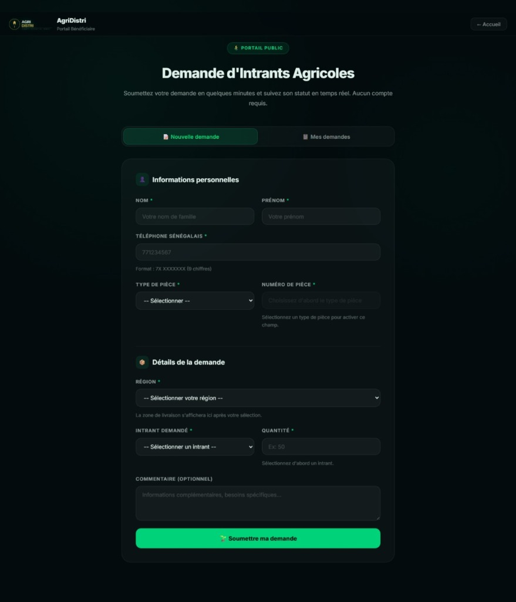

# AgriDistri

Application web de distribution d'intrants agricoles (semences, engrais, pesticides) au Sénégal. Un agriculteur dépose une demande sans créer de compte, un distributeur la valide ou la rejette selon son stock, et un administrateur suit l'ensemble.

## Technologies

- Python / Flask (API REST)
- SQLite
- HTML, CSS et JavaScript sans framework
- Authentification JWT en cookies HttpOnly, limitation de débit, journal d'audit

## Captures d'écran




## Lancer le projet

Prérequis : Python 3.10 ou plus.

```powershell
py -3 -m venv .venv
.\.venv\Scripts\Activate.ps1
python -m pip install -r requirements.txt
copy .env.example .env
python server.py
```

Avant de lancer, remplacez `SECRET_KEY` et `JWT_SECRET_KEY` dans `.env`. Pour générer une clé :

```powershell
python -c "import secrets; print(secrets.token_hex(32))"
```

Le serveur démarre sur http://127.0.0.1:3000. La base `agridistri.db` est créée au premier lancement, avec les comptes `admin`, `distributeur1` et `distributeur2`. Leurs mots de passe ne sont pas fournis : définissez-les vous-même (voir ci-dessous).

### Définir un mot de passe

```python
import sqlite3
from werkzeug.security import generate_password_hash

conn = sqlite3.connect('agridistri.db')
conn.execute("UPDATE distributeurs SET password = ? WHERE username = ?",
             (generate_password_hash('nouveau-mot-de-passe'), 'admin'))
conn.commit()
```

## Pages

| Page | URL |
|---|---|
| Accueil | `/` |
| Demande d'intrants (public) | `/beneficiaire-demande.html` |
| Connexion admin / distributeur | `/login.html` |

## Rôles

- **Bénéficiaire** : dépose une demande et suit son statut avec son numéro de téléphone.
- **Distributeur** : valide ou rejette les demandes de sa zone et gère son stock.
- **Administrateur** : statistiques, demandes, stocks, utilisateurs et journal d'audit.

## Structure

```text
server.py                  serveur Flask et routes API
database.py                création de la base SQLite
index.html                 accueil
beneficiaire-demande.html  portail bénéficiaire
login.html                 connexion
portail-distributeur.html  tableau de bord distributeur
portail-admin.html         tableau de bord administrateur
style.css                  styles
tests/                     tests
.env.example               modèle de configuration
```

## Tests

```powershell
python -m pytest tests
```

## Contact

bdankoco@gmail.com
